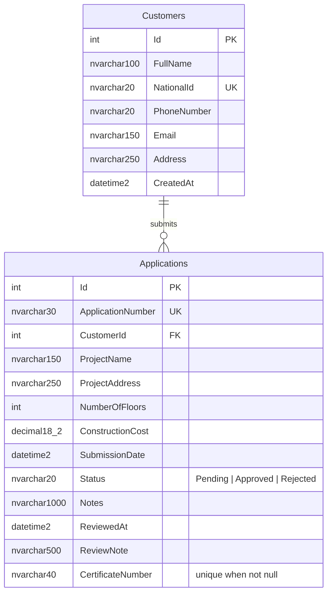

# BuildSure – Architecture

## 1. Solution layout

| Project | Type | Target | Built with |
|---|---|---|---|
| `src/BuildSure.Web` | ASP.NET Core MVC | `net10.0` | `dotnet build` (in `BuildSure.sln`) |
| `tests/BuildSure.Tests` | xUnit | `net10.0` | `dotnet test` (in `BuildSure.sln`) |
| `demos/BuildSure.WinForms` | Windows Forms | `net10.0-windows` | `dotnet build` (in `BuildSure.sln`) |
| `demos/BuildSure.WebForms` | ASP.NET Web Forms (classic csproj) | .NET Framework 4.8 | Visual Studio MSBuild on its own `.csproj` (listed in `BuildSure.sln`, excluded from its build) |

The Web Forms project is listed in the solution, but it has no `Build.0` entries (only `ActiveCfg`), so
`dotnet build BuildSure.sln` skips it and still works on machines without the .NET Framework web targets.

The three demo/legacy projects are independent. They share only the **database** with the MVC app.

## 2. MVC app layers

```
Browser (Razor HTML + Bootstrap + jQuery)
   │  HTTP (form posts, GET, AJAX with X-Requested-With)
   ▼
Controllers ──────────────► ViewModels (form/page shapes)
   │  HomeController          DashboardViewModel, ApplicationFormViewModel,
   │  CustomersController ─┐  ApplicationListViewModel, ReportsViewModel
   │  ApplicationsController│
   │  ReportsController ────┤
   ▼                        │ (Customers & Reports use the DbContext directly:
Services                    │  plain CRUD / read-only, no business rules)
   │  IApplicationService   │
   │  ApplicationService    │
   ▼                        ▼
Data: BuildSureDbContext (EF Core) ──► SQL Server (LocalDB in dev)
```

- **Controllers** handle HTTP: binding, validation, choosing a View/Redirect/Json/PartialView.
- **ApplicationService** holds every workflow rule. It returns `OperationResult` for rule
  failures instead of throwing exceptions.
- **No repository layer.** `DbContext` already provides the unit-of-work and repository
  behaviour. Another abstraction layer would add complexity without benefit in a project this size.
- **DI registrations** (`Program.cs`): DbContext (scoped), `IApplicationService` (scoped),
  `TimeProvider.System` (singleton, so tests can control the clock).

## 3. Data model



| Object | Created by | Purpose |
|---|---|---|
| `PK_Customers`, `PK_Applications` | Migration `InitialCreate` | Clustered primary keys (IDENTITY) |
| `FK_Applications_Customers_CustomerId` | `InitialCreate` | One-to-many, `ON DELETE NO ACTION` (EF `Restrict`) |
| `IX_Customers_NationalId` (unique) | `InitialCreate` | One customer per National ID |
| `IX_Applications_ApplicationNumber` (unique) | `InitialCreate` | Unique application numbers |
| `IX_Applications_CertificateNumber` (unique, filtered `IS NOT NULL`) | `InitialCreate` | Unique certificates. Requires `QUOTED_IDENTIFIER ON` for writes |
| `IX_Applications_Status`, `IX_Applications_CustomerId` | `InitialCreate` | Filtering and joins |
| `vw_CustomerApplicationSummary` | Migration `AddReportingViewAndProcedure` | Per-customer counts (LEFT JOIN + GROUP BY) |
| `usp_GetApplicationsByStatus` | `AddReportingViewAndProcedure` | Applications joined to customers, optional `@Status` |
| `usp_GetApplicationStatistics`, `usp_ApproveApplication` | `database/03_stored_procedures.sql` only | SQL learning examples. The app doesn't use them |
| `IX_Applications_SubmissionDate` | `database/01_keys_and_indexes.sql` only | Index-creation example, outside the migrations |

## 4. Workflow (state machine)

```
            Create
  (none) ───────────► Pending ──Approve──► Approved  (CertificateNumber = SIM-CERT-{yyyy}-{Id:D6})
                         │
                         └──Reject(reason)──► Rejected
```

| Rule | Enforced in |
|---|---|
| New application is always Pending | `ApplicationService.CreateAsync` |
| Only Pending can be edited / approved / rejected | `ApplicationService` (+ UI hides buttons, Edit GET redirects) |
| Reject needs a non-empty reason (≤ 500 chars) | `ApplicationService.RejectAsync` + jQuery check |
| Approved applications can't be deleted | `ApplicationService.DeleteAsync` (+ UI hides button) |
| Customers with applications can't be deleted | `CustomersController.Delete` + database FK |
| National ID unique | `CustomersController` check + unique index |
| Customer must exist for an application | `ApplicationsController.ValidateCustomerAsync` + FK |

## 5. Key technical decisions

| Decision | Why |
|---|---|
| .NET 10 (LTS) | Newest supported LTS SDK on the machine (10.0.401) |
| SQL Server LocalDB | Installed locally, no setup needed. The connection string can be changed for full SQL Server |
| Enum stored as string (`HasConversion<string>()`) | Readable data and SQL scripts (`WHERE Status = 'Pending'`) |
| ViewModel for application forms, `[Bind]` for customer forms | Shows both ways to prevent over-posting |
| View and SP created inside a migration (`migrationBuilder.Sql`) | Every environment gets them with `dotnet ef database update` |
| Development auto-migrates and seeds (`Database:MigrateAndSeedOnStartup`) | Easy first run. It's off by default in `appsettings.json` (Production) |
| Times stored in UTC, shown with `ToLocalTime()` | Standard practice |
| Application number `APP-yyyyMMdd-XXXXXX` (6 hex characters from a GUID) + unique index | Simple and readable. A collision would surface as a DB error (very unlikely) |
| jQuery progressive enhancement | Every AJAX feature has a non-JS fallback (form post / GET) |
| Tests use EF Core InMemory | Fast, no SQL Server needed. FKs and raw SQL are not covered (see limitations) |
| Web Forms in the solution but excluded from its build | Visible in Solution Explorer; the `dotnet` CLI can't build classic web projects |

## 6. Cross-cutting

- **Security:** anti-forgery tokens on every POST (including AJAX). Parameterised SQL
  everywhere (EF, `SqlQuery` interpolation, ADO.NET parameters). Razor HTML-encodes output, and
  jQuery uses `.text()` for server messages. There is **no authentication** (training scope).
- **Logging:** default ASP.NET Core logging. In Development, EF Core prints the SQL it runs.
- **Configuration:** `appsettings.json` → `appsettings.{Environment}.json` → environment
  variables (e.g. `ConnectionStrings__BuildSureDb`).
